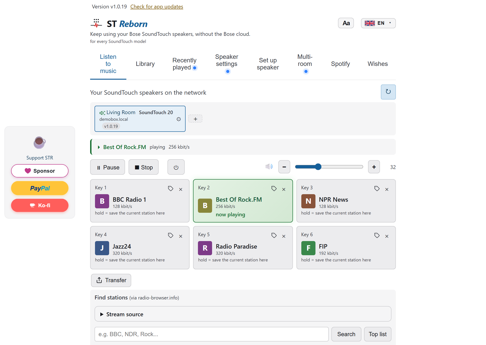

# STR, SoundTouch Reborn

**Cloud free firmware project for Bose SoundTouch speakers.**

  
  
  
  
  

  

Bose switched the SoundTouch cloud off for good on 6 May 2026. STR keeps the speakers usable: a small agent is installed onto the speaker itself, stands in for the cloud locally, and brings back internet radio, Spotify, your own music library, multiroom, and the preset buttons. **The install runs over your home network from the desktop app**, no USB stick needed, and the agent starts with the speaker on every boot.

## What you get

- Internet radio from tens of thousands of stations, searchable, no account.
- The six preset keys on the speaker and the remote work again.
- Spotify Connect, including Spotify playlists on the preset keys.
- Your own music from a media server at home (FRITZ!Box, Synology, Plex and others).
- Multiroom groups and stereo pairs.
- A phone remote in the browser of every phone, no app store and no account.
- Alarm clock, sleep timer, backup and restore, and a full "Uninstall STR".

The complete list, what is in the works, and more screenshots: [`docs/FEATURES.md`](./docs/FEATURES.md).

## Supported speakers

SoundTouch 10, 20, 30 and Portable, the SoundTouch 300 and 520, the Wave SoundTouch III and IV, the SA-4 and SA-5 amplifiers, CineMate 520, 220, 130 and 120, Lifestyle 535, 600 and 650, and the Wireless Link Adapter. Details per model in [`docs/MODELS.md`](./docs/MODELS.md). If yours is not listed, I would like to hear from you.

## Install

Download the app for Windows, macOS or Linux from **[st-reborn.de](https://st-reborn.de)**, open it on a computer in the same Wi-Fi as your speaker, and follow the setup. On macOS `brew install --cask jrpersonal/tap/st-reborn` works too; more in [`packaging/README.md`](./packaging/README.md).

Speaker firmware too old? [`docs/FIRMWARE-UPDATE.md`](./docs/FIRMWARE-UPDATE.md) shows how to bring it to Bose's last version.

## Community apps

Independent community projects that build on STR:

- [STR Remote](https://apps.apple.com/app/id6811924121) for iPhone, free, by Wagges ([discussion #1233](https://github.com/JRpersonal/streborn/discussions/1233)).
- [SoundFork](https://github.com/twitnic/SoundFork) for Android 14 and newer, by twitnic, early version without a download yet ([discussion #456](https://github.com/JRpersonal/streborn/discussions/456)).
- [SoundRebornRemote](https://github.com/ben240374/SoundRebornRemote) for Android 7 and newer, by ben240374, early version with an APK on GitHub.

## Help and community

- Questions and ideas: [GitHub Discussions](https://github.com/JRpersonal/streborn/discussions). Vote on what comes next in the [Ideas](https://github.com/JRpersonal/streborn/discussions/categories/ideas) category.
- Bug reports: [Issues](https://github.com/JRpersonal/streborn/issues), with a diagnostic log from the app ("Save diagnostic log" at the very bottom).
- Security reports: [SECURITY.md](./SECURITY.md).

## Further reading

- **Security, privacy and verifying a download:** [`docs/SECURITY-OVERVIEW.md`](./docs/SECURITY-OVERVIEW.md), threat model in [`docs/THREAT-MODEL.md`](./docs/THREAT-MODEL.md).
- **Home Assistant and automation:** [`docs/HOME-ASSISTANT.md`](./docs/HOME-ASSISTANT.md), [`docs/CONTROL-API.md`](./docs/CONTROL-API.md), [`docs/AUTOMATION.md`](./docs/AUTOMATION.md).
- **Developers:** [`CONTRIBUTING.md`](./CONTRIBUTING.md) (build, repository layout) and [`docs/ARCHITECTURE.md`](./docs/ARCHITECTURE.md).
- **What 1.0 means and what comes after:** [`docs/ROADMAP.md`](./docs/ROADMAP.md).
- **Credits:** [`docs/ACKNOWLEDGEMENTS.md`](./docs/ACKNOWLEDGEMENTS.md) and [THIRD-PARTY-NOTICES.md](./THIRD-PARTY-NOTICES.md).

## Support the project

STR is free and funded by donations.

More payment options on [st-reborn.de](https://st-reborn.de/#donate).

## Disclaimer

STR is an independent open source project. The abbreviation **ST** references compatibility with Bose SoundTouch family speakers. STR is **not affiliated with, endorsed by, sponsored by, or otherwise connected to** Bose Corporation. **Bose** and **SoundTouch** are registered trademarks of Bose Corporation in the United States and other countries.

STR exists solely to restore functionality of these speakers after the official Bose cloud service shutdown on 6 May 2026. Reverse engineering for interoperability is permitted under EU Directive 2009/24/EC, Article 6, and comparable provisions in other jurisdictions.

The software is provided AS IS, without warranty. Use at your own risk. The full disclaimer is in [DISCLAIMER.md](./DISCLAIMER.md).

## License

STR is licensed under the [Apache License 2.0](./LICENSE). Releases up to and including v1.0.12 were published under the MIT License, which still applies to them.

You may use, change and redistribute STR, also commercially. A work based on STR has to keep the [NOTICE](./NOTICE) file and show its attribution wherever it shows its other credits.

**The names "STR", "ST Reborn" and "SoundTouch Reborn" are not part of the license.** A fork or derived work must use a name of its own, so users can tell it apart from this project.

See [DISCLAIMER.md](./DISCLAIMER.md) for the trademark and interoperability notice. The bundled go-librespot binary is GPL-3.0; see [`docs/ACKNOWLEDGEMENTS.md`](./docs/ACKNOWLEDGEMENTS.md).
