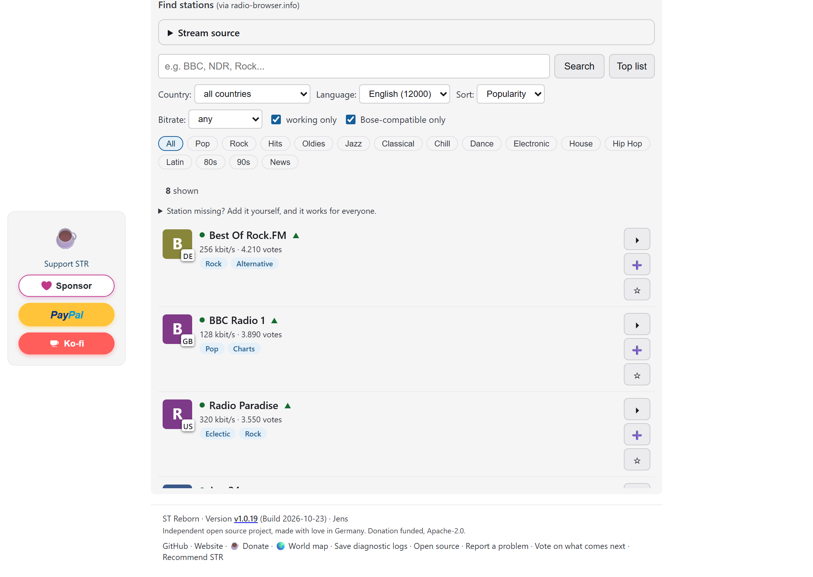
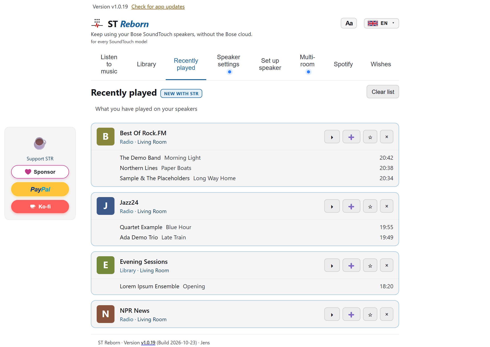
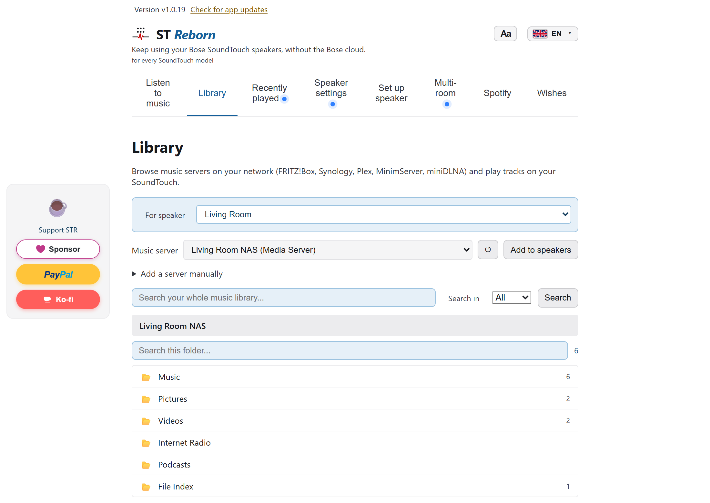
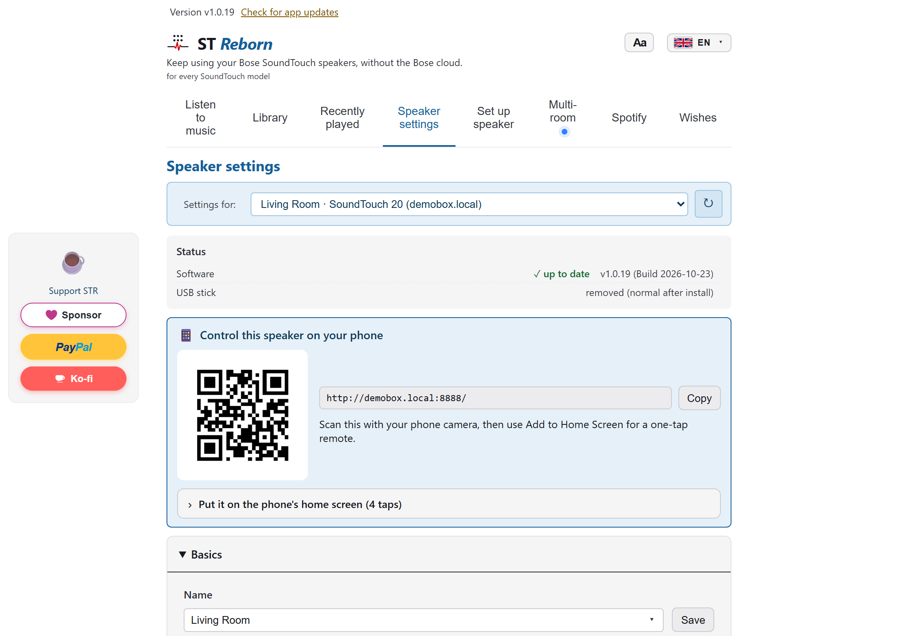
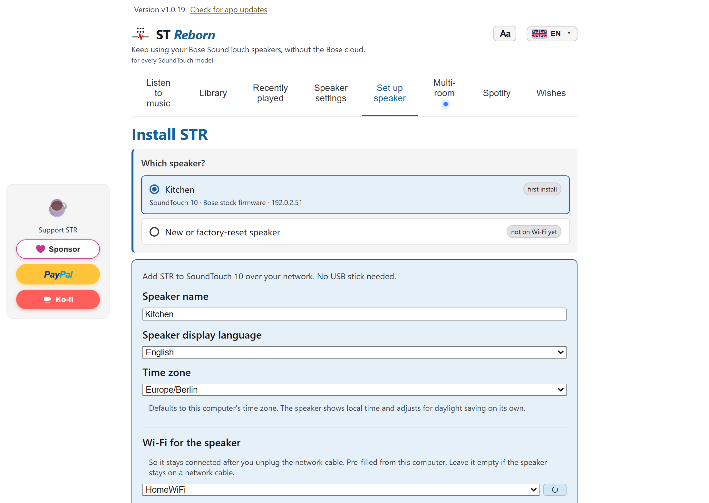
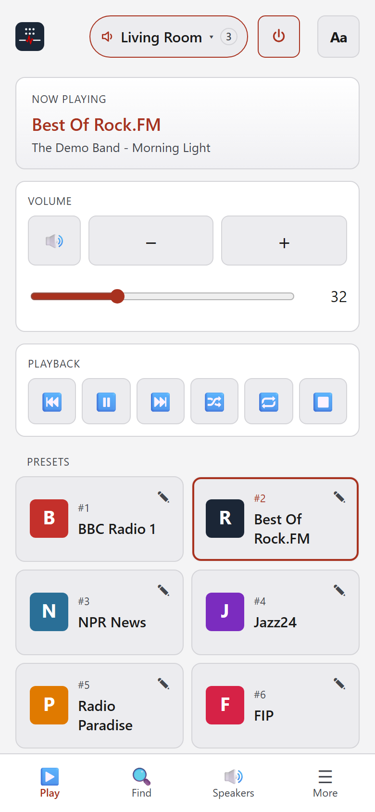
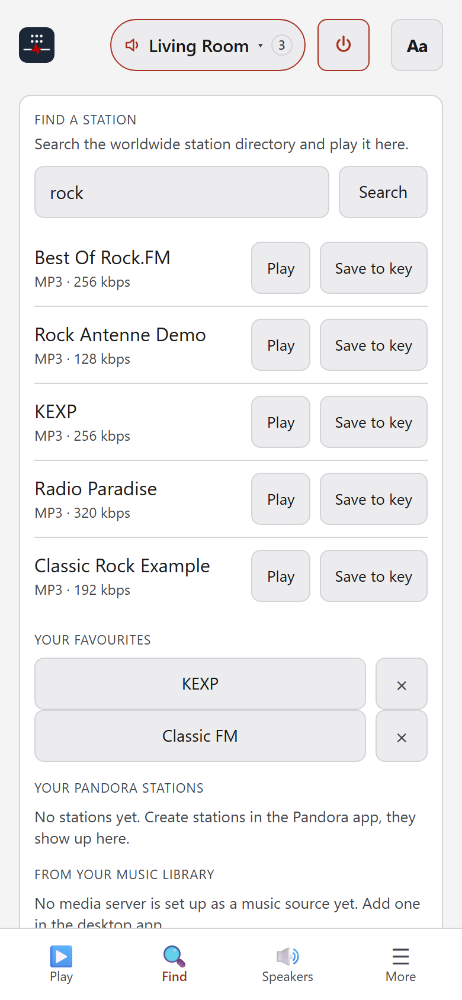
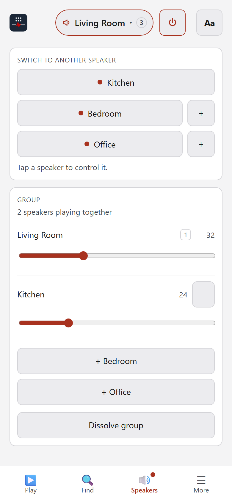
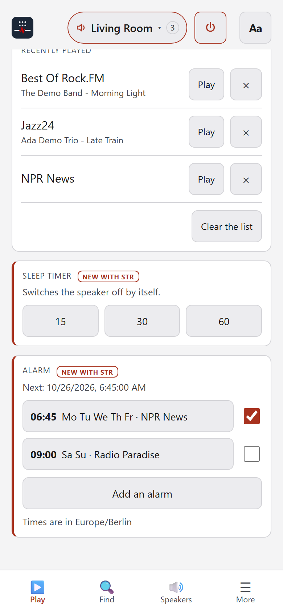

# STR features

The full list of what STR does today, and what is being worked on. The short version is in the [README](../README.md).

## How it works in one paragraph

The desktop app finds the speaker on the network, reaches it on its setup port and copies the agent into the speaker's persistent storage. From then on it starts automatically every time the speaker powers on. A USB stick is still supported as a fallback and recovery path, but it is no longer the normal way to install. It hosts a stand-in for the Bose cloud on the loopback interface and redirects the relevant DNS names so the speaker treats it as the real cloud. Playback then happens over UPnP AVTransport on the speaker, which is supported natively, whether the source is an internet radio station, a Spotify playlist, or a track from a media server on your own network. The hardware preset buttons are wired through the speaker's local WebSocket, so a button press recalls the saved source; the same bus lets a remote key fire a webhook to control your smart home. Several speakers can be grouped into a multiroom zone or a stereo pair.

## What works

- Discovery of speakers running STR over mDNS, list view in the desktop app. Speakers without STR show up too, marked "ready for STR", and can be installed in-app.
- Playback control: play / pause / stop / volume / bass / source switch (AUX, Bluetooth, Standby) via the speaker's existing UPnP AVTransport endpoint on port 8091. I never route audio through the dead Bose cloud.
- Phone remote: every speaker serves its own remote in the browser. Scan the QR code in the desktop app's speaker settings, add the page to your phone's home screen, and control that speaker, group it, and browse stations and your library from Android or iPhone, with no app store and no account.
- Radio search via radio-browser.info, queried directly by the desktop app (no API key); only the final stream URL goes to the speaker. HLS-only stations (BBC and co.) are converted on the fly by the agent's stream proxy. On a blocked or dead stream the app automatically tries another listing of the same station.
- Six preset slots, persisted by the agent on the speaker. Hardware preset buttons 1 to 6 work after install via a hook into Bose's WebSocket bus (gabbo), and they survive a cold boot, a standby cycle and a Wi-Fi outage. Internet radio presets are registered with the speaker's own radio source, so the speaker starts them itself. Keys can be renamed, a station already on another key can be moved to the key you pressed, and existing non-STR presets (e.g. Deezer) are left untouched. Presets copy from one speaker to the others in one step, and holding a key on the speaker saves whatever STR is playing, Spotify and the music library included.
- Radio sources of the speaker itself: TuneIn stations play through the speaker's own TuneIn source, and on US speakers Pandora and iHeartRadio stations can be stored on the preset keys.
- Favourites beyond the six keys: starred stations are stored on the speaker, so the phone remote shows the same list as the desktop app.
- Alarm clock: wake up to one of your six presets at a set time and volume, per weekday.
- Volume details: a fixed start volume per speaker (off by default), a maximum volume per speaker that the app, Spotify, the remote and the speaker's own buttons cannot go past (off by default), mute, left/right balance for a stereo pair, and separate centre and surround levels on a soundbar.
- Spotify Connect: a supervised go-librespot sidecar on the speaker. Spotify playlists, albums, and tracks save to preset slots and the hardware buttons, with multi-account switching and live now-playing. The raw Ogg stream is decoded by the speaker, never by the dead cloud. Streaming quality is set per speaker (160 or 320 kbps), and one click copies a Spotify login to every speaker so saved Spotify presets play on all of them.
- Local media library: browse media servers on your home network over DLNA / UPnP AV (SSDP discovery, ContentDirectory browse), including FRITZ!Box, Synology, Plex and miniDLNA, and save any track as a preset. Lossless files (FLAC) play directly; the agent's stream proxy feeds the box.
- Multiroom zones and stereo pairs: group several speakers to play in sync, or pair two as a left/right stereo pair under a name of your own. A group can be made permanent: it persists on the speaker, reforms automatically after a reboot, standby cycle, or Wi-Fi outage, and takes members back that dropped out. A saved group can sit on a thumbs key of the remote, one press forms it and the next dissolves it.
- Smart-home triggers (webhooks): turn a remote-control key (Back, Forward, Thumbs up and down, Play/Pause each on its own), the power button, or an AUX change into a user-configured HTTP call, UDP packet, or Wake-on-LAN magic packet, so a press can drive Home Assistant, ioBroker, Node-RED, wake a PC, or anything reachable on the network.
- OTA agent updates from the desktop app, with an SSH fallback and a pre-reboot stick refresh so the update cannot be reverted by the boot sync. Build stamp comparison catches version drift.
- WLAN reconfigure from the desktop app. I rewrite `/etc/wpa_supplicant.conf` in full because appending breaks Wi-Fi.
- Setup wizard for the install, including preset region, friendly name, box language, and Wi-Fi credentials. The network install is the normal path; the USB stick route (with a bundled FAT32 formatting helper) remains available as a fallback.
- Backup and restore: save your favourites and every speaker's preset keys to one file, and restore them, for example before you rebuild.
- Sleep timer: switch a speaker, or a whole group, off by itself after a set time, from the phone remote.
- Home Assistant and other automation: STR keeps the speaker's local control API (`:8090`) and UPnP media renderer (`:8091`) alive, so a hub you run at home can control the speakers, send audio or TTS to them, and, via Alexa or Google, do voice control. STR adds its own local REST API on top. No cloud skill of my own. See [`docs/HOME-ASSISTANT.md`](HOME-ASSISTANT.md).
- Help when a speaker's firmware is too old: a step-by-step guide with Bose's own download link, and a one-click update to Bose's last firmware. Very old speakers that need several updates in a row are covered in [`docs/FIRMWARE-UPDATE.md`](FIRMWARE-UPDATE.md). If the Windows firewall blocks STR, the app says so and can allow it with one click.
- Speakers with a display show a short message when a key cannot play, and an STR logo animation after an install or update.
- Wishes tab: every open feature wish with its votes, in the app's language and searchable, with links to vote and to suggest a new one.
- Diagnostics export (anonymised), true factory reset, and a full "Uninstall STR" that returns the speaker to stock.
- And one thing that was never in the manual: a game hidden on the display of the SoundTouch 20, 30 and Portable. How to start it is a riddle in the [Arcade](https://github.com/JRpersonal/streborn/discussions/1173), and that is also where the highscores go.
- And yes, it runs DOOM. That one lives in its own repo, [streborn-doom](https://github.com/JRpersonal/streborn-doom), and STR never installs it.

# In the works, and what comes next

- **Podcasts**: search a show, play episodes, and put the newest episode of a show on a preset key ([#1167](https://github.com/JRpersonal/streborn/discussions/1167)).
- **An app for the phone remote** on Android ([#1123](https://github.com/JRpersonal/streborn/discussions/1123)), and updating speakers from the phone without a PC ([#1091](https://github.com/JRpersonal/streborn/discussions/1091)).
- **More streaming sources**: SoundCloud ([#1122](https://github.com/JRpersonal/streborn/discussions/1122)) is at the feasibility stage. Deezer ([#1239](https://github.com/JRpersonal/streborn/discussions/1239)), Tidal, YouTube Music and SiriusXM have no open playback API, so each would need a separately maintained bridge like the one STR uses for Spotify. Existing Deezer presets on a speaker survive an install untouched.
- **You decide the order.** Every open idea has its own discussion in the [Ideas category](https://github.com/JRpersonal/streborn/discussions/categories/ideas?discussions_q=category%3AIdeas+sort%3Atop), and the app's Wishes tab lists them too. Upvote what you want; the curated overview is [#1591](https://github.com/JRpersonal/streborn/discussions/1591).

## Screenshots

The desktop app: browse and assign presets, search internet radio, control Spotify, browse your local media library, manage speaker settings, and install STR onto a speaker over the network.

| | | |
|:--:|:--:|:--:|
|  |  |  |
| Presets and playback | Internet radio search | Recently played |
|  |  |  |
| DLNA music library | Speaker settings and phone QR code | Install STR over the network |

### Phone remote

Every speaker running STR serves its own remote in the phone browser: scan the QR code in the speaker settings and add the page to the home screen. No app store, no account.

  
  
  
  

The interface is available in thirteen languages (English, German, French, Spanish, Japanese, Ukrainian, Dutch, Polish, Lithuanian, Latvian, Turkish, Arabic, Traditional Chinese). The full per-language screenshot set lives in [`docs/screenshots/`](screenshots/) and is regenerated automatically with `npm run shoot` in `desktop-app/frontend/screenshots/`, a headless Playwright harness that mocks the backend with demo data, so no speaker is needed; `npm run shoot-phone` does the same for the phone remote.
