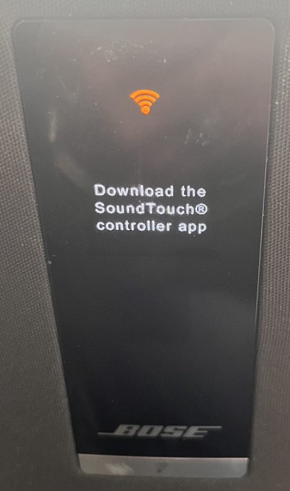

# Bringing a speaker to firmware 27.0.6

**What this is, and do I need it?** Every SoundTouch speaker runs
software from Bose that is built into the speaker, its *firmware*. STR
needs the last version Bose ever released, **27.0.6** (September 2022).
Many speakers already have it. If yours runs an older version, this page
shows how to bring it up to 27.0.6 before you install STR. If your
speaker already shows 27.0.6, there is nothing to do here.

STR does not host, mirror or change any firmware file. Every link on
this page points at Bose's own server or at the Internet Archive.

<details>
<summary>More detail: are Bose's files still available?</summary>

STR is built and tested against Bose firmware **27.0.6.46330.5043500**,
the last release Bose ever published (September 2022). A speaker that
never got that far can still be brought to it, including the in-between
steps very old speakers need.

Bose's end-of-life page says "firmware updates are no longer available
now that the cloud is offline". That is about the update button in the
Bose app, which asked a server that is gone. It is not true of the files
themselves: Bose's own download host still serves them. Only the web
pages that used to link them were taken down. Verified on 2026-09-08.

</details>

**Four words you will meet on this page**

- **Firmware**: the software Bose built into the speaker. It is not STR.
- **USB stick** (also called flash drive or thumb drive): the small
  memory stick you plug into a computer.
- **FAT32**: a way of preparing (formatting) a USB stick so the speaker
  can read it. Windows and macOS can both do it.
- **OTG adapter**: a small plug adapter that lets a normal USB stick go
  into the much smaller socket on the SoundTouch 10 and the Portable.
  [Section 5](#the-port) shows what it looks like.

**Contents**

1. [Find the version your speaker runs now](#1-find-the-version-your-speaker-runs-now)
2. [Pick your route](#2-pick-your-route)
3. [Route A: one click in ST Reborn](#3-route-a-one-click-in-st-reborn)
4. [Route B: Bose's update page on the speaker's own Wi-Fi](#4-route-b-boses-update-page-on-the-speakers-own-wi-fi)
5. [Route C: USB stick](#5-route-c-usb-stick)
6. [What you see while it updates](#6-what-you-see-while-it-updates)
7. [Very old firmware: the step-by-step ladder](#7-very-old-firmware-the-step-by-step-ladder)
8. [Checking a download](#8-checking-a-download)
9. [Bose's files for 27.0.6, per model](#9-boses-files-for-2706-per-model)
10. [If you are stuck, send us this](#10-if-you-are-stuck-send-us-this)
11. [What is verified and what is not](#11-what-is-verified-and-what-is-not)
12. [Every source](#12-every-source)

---

## 1. Find the version your speaker runs now

You need the first two or three numbers, for example `9.0.41` or
`27.0.3`. Use whichever of these you can reach:

- **ST Reborn.** Open the app and let it find the speaker. The firmware
  version is listed in the speaker's settings. If the app does not find
  the speaker on your network, the setup screen also shows the version
  once it reaches the speaker.
- **Bose SoundTouch app**, if you still have it. Open the settings,
  pick the speaker and look at its speaker information.
- **On the speaker itself**, on models with a display: hold **5** and
  **Volume minus** together until the display shows the version.
  Reported by owners, not tested by me.

Anything that does not start with `27.` needs this page. `27.0.6` is the
end of the line. There is nothing newer.

<details>
<summary>More detail: read the version from the speaker's info page</summary>

In a browser on the same network, open
`http://<speaker address>:8090/info`. Look for `softwareVersion` next to
`SCM`. Your router's device list shows the speaker's address.

If the speaker is not on your network, put it into setup mode
([section 4](#4-route-b-boses-update-page-on-the-speakers-own-wi-fi),
steps 2 and 3), join its own Wi-Fi and open
`http://192.0.2.1:8090/info` (or `http://192.168.1.1:8090/info`).
Unverified on very old firmware.

</details>

## 2. Pick your route

Try these in order. Stop as soon as the speaker shows 27.0.6.

1. **Bose's own SoundTouch app.** Set the speaker up in the Bose
   SoundTouch app and connect it to your Wi-Fi. If the app then offers a
   firmware update, take it and let the speaker restart by itself.
   Bose's end-of-life page says firmware updates are no longer offered,
   so do not count on this. If the app shows no update, or cannot add
   the speaker, go on with step 2.
2. **ST Reborn.** Install ST Reborn on a computer
   ([st-reborn.de](https://st-reborn.de)), open it and let it find the
   speaker. When the speaker's firmware is too old, the app shows a
   firmware notice. Follow it:
   - If it shows an **Update now** button, click it.
     [Section 3](#3-route-a-one-click-in-st-reborn) shows what happens.
   - If it shows numbered steps with a **Prepare stick** button, follow
     them one at a time. [Section 3](#when-the-app-shows-numbered-steps)
     walks you through them.
   - If it says there is no tested path yet for your speaker, read
     [When there is no tested path yet](#when-there-is-no-tested-path-yet)
     below.
3. **By hand**, only when steps 1 and 2 cannot help: Bose's update page
   ([Route B](#4-route-b-boses-update-page-on-the-speakers-own-wi-fi))
   or a USB stick ([Route C](#5-route-c-usb-stick)).

**Update the firmware before you install STR.** STR is tested on 27.0.6
only. Three field reports failed at install on older firmware.

### What ST Reborn can do for your speaker today

On firmware **15 or newer**, the app offers **Update now** for every
model, as long as it can name the one Bose file that fits the speaker.

On firmware **14 or older**, one update straight to 27.0.6 does not
work. The speaker needs several updates in a row, and that is only
checked for some models so far:

| Your speaker | On firmware 14 or older, today |
|---|---|
| SoundTouch 20 or 30 without a Bluetooth button (first generation), SoundTouch Portable | **Numbered steps in the app.** The app prepares every USB stick for you. Each step up to 16.00.09 worked on one SoundTouch 20. The last step from there is not tested yet. |
| SoundTouch 10 | **No tested path yet.** Below 15, the app lists a probable route (15.00.20, then 27.0.6), but cannot prepare the stick for it. |
| SoundTouch 20 or 30 with a Bluetooth button, SA-5, SoundTouch 300, Wireless Link adapter | **No tested path yet.** The app lists a probable route, but cannot prepare the stick. |
| Wave SoundTouch (first generation), CineMate adapter (first generation) | **No tested path yet.** The app lists a probable route, but cannot prepare the stick. |
| Wave SoundTouch IV | From 14.0.33: probable route listed, not tested. Below 14.0.33: no known source for the first step. |
| SA-4, Stereo JC (first generation) | On 14.x: probable route listed, not tested. Below 14: no known source for the first step. |
| Any other model | No known path yet. |

### When there is no tested path yet

For some speakers I do not have a checked list of in-between updates
yet. A SoundTouch 10 below firmware 15 is one of them. The app then
lists the probable route, says it is not checked, and cannot prepare
the USB stick. Or it says "No known update path for this speaker yet".

What you can do:

- **Wait.** I am working on checked steps for more models, the
  SoundTouch 10 first. If the app later shows numbered steps with a
  **Prepare stick** button for your speaker, follow them. Keep ST
  Reborn up to date: it updates itself in place.
- **Tell me about your speaker.** Write to me
  ([section 10](#10-if-you-are-stuck-send-us-this)) with the model and
  the version. That helps me decide which model comes next, and I can
  write back when there is news.
- **Do not put 27.0.6 on in one go.** From firmware 14 or older, that
  jump stalled or ended in a restart loop on the speakers that tried
  it.
- **If you want to try the probable route yourself, write to me first.**
  It is not tested. An interrupted or wrong update can leave the
  speaker unusable.

Until then, the speaker keeps working the way it does today.

<details>
<summary>More detail: the routes by version, and why there is no single jump</summary>

| Your version | Route |
|---|---|
| 27.0.6 | Nothing to do. |
| 15.x or newer | **Route A**, one click in ST Reborn. Untested on 15.x so far. If it fails, Route B or C with Bose's file from [section 9](#9-boses-files-for-2706-per-model). |
| 14.x or older | **The ladder in [section 7](#7-very-old-firmware-the-step-by-step-ladder)**, one USB stick step at a time. Do not jump straight to 27.0.6. |
| Unknown | Find it first. Hold **5** and **Volume minus**, or open the info page in setup mode ([section 1](#1-find-the-version-your-speaker-runs-now)). If you still cannot see it, ask me ([section 10](#10-if-you-are-stuck-send-us-this)). Do not put 27.0.6 on a stick blindly: on a 14.x speaker that jump can end in a restart loop. |

Why not jump from 14.x or older to 27.0.6 in one go? Readers tried. On
one speaker, both from 5.x and again from 06.02.01, the progress bar
stayed empty. On a 14.0.15 speaker the bar filled, then the speaker
restarted in a loop
([issue #854](https://github.com/JRpersonal/streborn/issues/854)).

Below 15 the app never offers Bose's last file in one jump, for any
model, and its own **Update now** refuses it too. The probable routes
per model are in
[section 7](#other-models-no-checked-ladder-yet).

</details>

## 3. Route A: one click in ST Reborn

This is the main way. You need a computer with ST Reborn on the same
home network as the speaker.

### When the app shows Update now

For speakers on firmware **15 or newer**.

1. Plug the speaker into power. A Portable belongs on its power supply,
   not on battery.
2. In ST Reborn, open the speaker's settings, or the setup screen. The
   firmware notice says the speaker needs an update. Click **Update
   now** and confirm.
3. The app shows what it is doing: "Checking Bose's file...", then
   "Downloading from Bose", then "Sending the update to the speaker".
4. The app says the speaker installs the update and restarts. Leave the
   speaker alone and powered. The whole update takes about ten minutes.
5. The app shows "Done. The speaker now runs firmware 27.0.6."

The speaker keeps its name, Wi-Fi and presets, and STR if it is
already installed.

If there is no **Update now** button, or the update fails, the app says
so and shows the steps by hand: Route B or C.

<details>
<summary>More detail: what Update now does, and what was tested</summary>

When the app sees a speaker older than 27.0.6, the firmware notice (in
the speaker's settings, and on the setup screen) has an **Update now**
button. The app then:

1. downloads Bose's file for exactly this model from Bose's own host and
   checks its size and checksum against Bose's catalogue. A file that
   does not match is thrown away, never sent;
2. sends it to the speaker's own update page over your home network.
   No setup mode, no USB stick, no change of Wi-Fi;
3. waits for the speaker to restart and shows the version it comes back
   with.

This also works on a speaker that already runs STR. A firmware update
replaces Bose's firmware only. STR, its settings, the speaker's name,
Wi-Fi and presets stay as they were (verified on a Portable on
2026-10-13: 27.0.3 to 27.0.6 on a stock speaker, and 27.0.6 over 27.0.6
with STR installed).

The button only appears when the app can name one file for the speaker
for certain. Below 15 it refuses Bose's last file: from there the
single jump stalls ([section 2](#2-pick-your-route)).

</details>

### When the app shows numbered steps

For a speaker on firmware **14 or older**, where the app has a checked
list of in-between updates ([section 2](#what-st-reborn-can-do-for-your-speaker-today)
says which). Each step is one update from a USB stick. You need an
empty USB stick of 2 to 8 GB, and for a SoundTouch 10 or a Portable an
OTG adapter ([section 5](#the-port)).

1. Read the warning at the top: the in-between files are copies kept by
   the Internet Archive, not by Bose. Tick **I understand and want to
   continue** and click **Start step 1**.
2. Put the USB stick into the computer. Pick it in the app and click
   **Prepare stick**. The app downloads the file, checks it, copies it
   to the stick and ejects the stick. Wait until it says "The stick is
   ready."
3. Take the stick to the speaker. The app shows the button steps for
   your speaker. Do them as shown (they are also in
   [section 5](#step-by-step)).
4. The display or the lights show that an update is running. Wait. It
   can take up to **45 minutes**. Do not unplug the speaker.
5. When the speaker has restarted by itself, pull the stick. On the
   computer, click **Done, check again**. The app reads the version and
   shows the next step. If it cannot reach the speaker, it asks which
   version the speaker shows now.
6. Repeat for every step. The last step is Bose's own 27.0.6, over the
   network or by stick.

The app remembers the step for each speaker, so you can stop between
steps and pick up later.

If something looks wrong while it updates,
[section 6](#6-what-you-see-while-it-updates) says what it means.

<details>
<summary>More detail: what the app checks before it writes the stick</summary>

The full list is in
[section 7](#let-the-app-do-the-stepping). In short: every file is
checked against the size and checksum the Internet Archive publishes,
and the `Update.stu` inside against its own size and CRC-32. A file
that does not match is never written to the stick.

</details>

## 4. Route B: Bose's update page on the speaker's own Wi-Fi

Use this when **Update now** in ST Reborn does not appear or does not
work, on a speaker with firmware 15 or newer. This is the route Bose's
own support articles describe. You need a computer with Wi-Fi and a
browser.

1. Download Bose's file for your model ([section 9](#9-boses-files-for-2706-per-model))
   and check it ([section 8](#8-checking-a-download)). Do not rename it.
2. Put the speaker into setup mode:
   - SoundTouch 10, 20, 30, Portable: hold **2** and **Volume minus**
     until the Wi-Fi light glows amber.
   - SoundTouch SA-5: hold the Control button for about 3 seconds.
   - SoundTouch 300: press SoundTouch on the remote, then hold **9**.
   - Wave SoundTouch: hold Control on the back of the pedestal for about
     3 seconds.
   - Wireless Link adapter: hold the button on the back for about 10
     seconds.
3. On the computer, join the speaker's own Wi-Fi. Its name starts with
   "Bose". Stay connected even if the computer says there is no
   internet.
4. Open `http://192.168.1.1:17008/update.html`. If that does not open,
   try `http://192.0.2.1:17008/update.html` (Bose's articles name both).
5. Click **Choose File**, pick the file, click **Upload**. A progress
   bar shows the update. Do not close the page or unplug the speaker
   until it restarts by itself.
6. Switch the computer back to your home Wi-Fi.

Very old firmware may not have this page. Then use Route C.

<details>
<summary>More detail: Bose's USB cable route</summary>

Bose also describes a USB cable route: connect the computer to the
speaker's USB port (the smaller one if there are two) and open
`http://203.0.113.1:17008/update.html` instead of steps 2 to 4.

</details>

## 5. Route C: USB stick

The speaker can install an update from a USB stick by itself. No app,
no network. If ST Reborn shows numbered steps for your speaker, it
prepares the stick for you, and you can go straight to
[The port](#the-port).

### The stick

- **Small: 2 to 8 GB is best.** Larger sticks often fail. Over 32 GB
  almost always fails.
- **Formatted as FAT32.** Not exFAT, not NTFS.
- **Only one file on it: `Update.stu`**, at the top level, not in a
  folder. No other files.
- **Keep the exact name `Update.stu`.** Do not rename it.
- **Eject the stick properly** before you pull it from the computer.

<details>
<summary>More detail: preparing the stick by hand</summary>

- Over 32 GB almost always fails, because the speaker cannot read the
  large clusters such sticks get. Windows offers FAT32 only for sticks
  up to 32 GB, one more reason to use a 2 to 8 GB stick.
- A browser that saves the file as `Update(1).stu` or `Update.stu.zip`
  breaks it. Check that file extensions are visible on your computer.
- Delete everything else, including hidden folders. If you can, format
  the stick fresh before you copy the file. On Windows: right-click the
  stick in File Explorer, choose **Format**, pick **FAT32**. On a Mac:
  Disk Utility, **Erase**, format **MS-DOS (FAT)**.
- **Formatting erases everything on the drive.** Before you click,
  check that the drive letter, name and size are the USB stick's, not
  another disk.
- For the ladder steps from the Internet Archive, the download is a
  zip. Open the zip and copy only the `Update.stu` inside it to the
  stick.

</details>

### The port

Where the stick goes depends on your speaker. Look at the back:

| Your speaker | Socket on the back | What you need |
|---|---|---|
| SoundTouch 10 | One small micro-USB socket | An OTG adapter (micro-USB to USB-A), or an OTG stick |
| SoundTouch Portable | One small micro-USB socket | An OTG adapter (micro-USB to USB-A), or an OTG stick |
| SoundTouch 20, first generation (no Bluetooth button) | Two sockets: **SETUP A** (micro-USB) and **SETUP B** (normal USB-A) | Nothing extra. Use **SETUP B**. |
| SoundTouch 30, first generation, with the same two sockets | **SETUP A** and **SETUP B** | Nothing extra. Use **SETUP B**. |
| SoundTouch 20 and 30, Series II and III | One normal USB-A socket | Nothing extra |
| Other models | Not described here yet | Photos are welcome ([Pictures](#pictures)) |

**What an OTG adapter is.** A normal USB stick has a wide, flat plug
(USB-A). The SoundTouch 10 and the Portable have a much smaller socket
instead, micro-USB, the kind many older phones used for charging: a flat
socket with two slanted corners. An OTG adapter is a
small piece, about the size of a fingertip, with a micro-USB plug on
one side and a normal USB-A socket on the other. Plug the stick into
the adapter and the adapter into the speaker.

Electronics shops, phone accessory shops and online shops sell it as
"micro-USB OTG adapter". It is inexpensive. Make sure it says
**micro-USB**: many adapters sold today are for USB-C, an oval plug
that does not fit these speakers. An *OTG stick* is a USB stick with
both plugs built in, micro-USB and normal USB-A, so it needs no
adapter. A plain micro-USB charging cable does not work.

<details>
<summary>More detail: why SETUP B on the first generation SoundTouch 20 and 30</summary>

SoundTouch 20 of Series I (no Bluetooth button) has two sockets on the
back: **SETUP A** (micro-USB) and **SETUP B** (USB-A). Use **SETUP B**,
the normal USB-A socket; Bose's own USB update instructions use it too.
No OTG adapter needed. A first generation SoundTouch 30 with the same
two sockets: the same rule.

</details>

### Step by step

This takes up to 45 minutes. Keep the speaker near a power socket.

1. **Portable: plug into the power supply first** and keep it plugged
   in until the end.
2. **Reset the speaker first.** Hold **1** and **Volume minus** together
   for about 10 seconds, until the speaker restarts. **This is Bose's
   factory reset.** It erases the presets, the speaker's name and its
   Wi-Fi, and you have to set the speaker up again afterwards. STR, if
   it is already installed, survives it. If you want to keep your
   presets, try steps 3 to 8 without it first.
3. **Switch the speaker off.** SoundTouch 10, 20, 30: unplug it from
   power. Insert the stick ([The port](#the-port) says where).
4. **Hold 4 and Volume minus**, and while you hold them, plug the power
   back in.

   **Portable:** its battery cannot be removed, so unplugging does not
   switch it off. Keep the power supply plugged in. Switch it off with
   its power button (or hold **AUX** for about 10 seconds). Insert the
   stick. Then hold **4** and **Volume minus** and, while you hold
   them, press the power button. Unverified.
5. **Let go when the display shows a hand or a progress bar** (or the
   lights change on models without a display).
6. **Wait.** Up to **45 minutes**. The bar can stand still for a long
   time. That alone is not a failure.
7. **Never unplug it while it updates.** This is the one dangerous
   moment of the whole procedure.
8. When the speaker has restarted, pull the stick and check the version
   again ([section 1](#1-find-the-version-your-speaker-runs-now)).

These button combinations are confirmed on the SoundTouch 20 only. If
your speaker does not react, look at Bose's update article for your
model ([section 12](#12-every-source)).

<details>
<summary>More detail: why the reset, and where the button combinations come from</summary>

The reset clears a half-finished setup that can make the speaker refuse
the file.

The button combinations in steps 2 and 4 come from owners and community
guides. They worked on SoundTouch 20 Series I and II. The Portable
variant of step 4 is untested. On other models they are not confirmed.

</details>

## 6. What you see while it updates

| What you see | What it means | What to do |
|---|---|---|
| A hand symbol, then a bar that fills | The update runs. | Wait. Do not touch the power. |
| The bar stands still for a few minutes | Normal. | Keep waiting, up to 45 minutes in total. |
| The bar stays **empty** for 30 minutes or more | The speaker did not accept this file. | Unplug power, wait 10 seconds, pull the stick, plug power back in. Check the version. If it did not change, use a smaller step from [section 7](#7-very-old-firmware-the-step-by-step-ladder), or try another, smaller stick. |
| The bar fills, then the speaker restarts again and again | The jump was too big for this speaker. | Pull the stick, unplug power, then try the ladder step for your version. Send me the details ([section 10](#10-if-you-are-stuck-send-us-this)). |
| After the update: an **orange Wi-Fi symbol and a book icon**, or an orange Wi-Fi symbol with "Download the SoundTouch controller app" (picture below) | **The update worked.** The speaker has forgotten its Wi-Fi and waits for setup. | Pull the stick. Set up Wi-Fi again with the Bose SoundTouch app (or ST Reborn's setup), or go straight on with the next stick step, which needs no Wi-Fi. Check the version before every step. |
| Nothing at all after plugging power in | The speaker did not see the stick or the combination. | Check the stick rules in [section 5](#the-stick), the name `Update.stu`, the OTG adapter, and try the combination again. |



*A first generation SoundTouch 20 right after 14.00.33 went in by stick.
Photo: a reader, shared with permission.*

Models without a display (SoundTouch 10, SA-5, Wireless Link) show the
update with their lights only. I do not have a confirmed description of
the light pattern per model yet. Photos are welcome.

<details>
<summary>More detail: where these observations come from</summary>

- **Empty bar**: seen on one speaker given 27.0.6 directly, from 5.x and
  again from 06.02.01, and given 15.00.20 from 14.00.33 (by stick and on
  its update page).
- **Restart loop**: seen once when 14.0.15 got 27.0.6 directly
  ([issue #854](https://github.com/JRpersonal/streborn/issues/854)).
- **Orange Wi-Fi symbol with "Download the SoundTouch controller app"**:
  seen after 14.00.33 on a first generation SoundTouch 20.

</details>

## 7. Very old firmware: the step-by-step ladder

A speaker on 14.x or older needs several updates in a row. Each step is
one USB stick update (Route C), and the version must be checked after
every step before the next one. Where ST Reborn has the steps, it does
all of this for you ([section 3](#when-the-app-shows-numbered-steps)).
The rest of this section is the reference behind it.

### Let the app do the stepping

For the first generation SoundTouch 20, 30 and Portable, ST Reborn walks
you through the ladder. When such a speaker reports a firmware older
than 15, the firmware notice turns into a numbered list of updates. The
app prepares each USB stick, shows the button steps for your speaker,
and after **Done, check again** moves on to the next step. The last step
is Bose's own 27.0.6, over the network or by stick. The app remembers
the step per speaker, so it picks up again after a restart.

For other models the app lists the probable route, says it is not
checked, and links this page. It cannot prepare the stick for those
steps, because their file names and checksums are not known yet. A
model with no known route gets a plain "no known path yet".

<details>
<summary>More detail: exactly what the app does in each step</summary>

For each step the app:

1. downloads that step's zip from the Internet Archive, on your
   computer, only when you click **Prepare stick** (or takes a zip or
   `Update.stu` you downloaded yourself);
2. checks the zip against the size and sha1 the Internet Archive
   publishes, and the `Update.stu` inside against its size and CRC-32
   (a file that does not match is never written);
3. takes ST Reborn's own install files off the stick, if the setup
   wizard put them there, together with the `setup.log` the speaker
   writes back to such a stick (only files ST Reborn writes itself,
   never yours; for anything else the log notes only how many files,
   their size and their extensions, never their names, and the app
   suggests an empty stick), then copies only `Update.stu` to the root
   of the stick you picked, reads it back, checks it again and ejects
   the stick;
4. shows the button steps for your speaker and, after **Done, check
   again**, reads the version and moves on to the next step.

The table the app uses lives in `desktop-app/bosefw/ladder_data.go`;
every value in it comes from the Internet Archive's metadata or the zip
itself, never from memory.

For the other models below, the app lists the probable route from the
table under "Other models", says it is not checked, and links this page.
Below 15 the app never offers Bose's last file in one jump, for any
model, and its own **Update now** refuses it too.

</details>

### Where the in-between files come from

Bose still serves its last versions, but not the old in-between ones.
For those, the only source I know is a community collection on the
Internet Archive:
<https://archive.org/details/bose-soundtouch-software-and-firmware>.

> **Read this before you use an archive file.** These copies are not
> from Bose. Somebody uploaded them in 2024. STR cannot check them
> beyond the size and sha1 the archive itself publishes, and the size
> and CRC32 of the `Update.stu` inside. Where an archived Bose catalogue
> lists the same file, I say so in the table. You use them at your own
> risk. An interrupted or wrong update can leave the speaker unusable.
> STR links these files and never copies or hosts them.

Two more rules:

- **Pick the folder for your speaker's generation.** First generation
  SoundTouch 20, 30 and Portable (no Bluetooth) take the
  `Airplay-1_ST20-30-Portable` files. The Bluetooth folders are for the
  newer chassis. The archive also contains files filed under the wrong
  model (listed below). Never use those.
- **The last step to 27.0.6 always comes from Bose**, never from the
  archive.

<details>
<summary>More detail: which versions Bose still serves</summary>

Bose still serves 26.0.1, 27.0.1, 27.0.2, 27.0.3 and 27.0.6. Its paths
for 14.0.33 up to 25.0.0 answer 403 (checked 2026-10-25).

</details>

### SoundTouch 20, 30 and Portable, first generation (no Bluetooth)

ST Reborn does these steps for you. The tables are here so you can
check what it does, or do it by hand.

**Which steps your speaker needs:**

| You are on | Steps, in this order |
|---|---|
| 5.x | 06.02.01, 07.00.37, 14.00.33, 16.00.09, 27.0.6 |
| 2.x or older | Unverified. See the note on 2.x below the tables. |
| 6.x | 07.00.37, 14.00.33, 16.00.09, 27.0.6 |
| 7.x up to 14.0.15 | 14.00.33, 16.00.09, 27.0.6 |
| 14.0.33 | 16.00.09, 27.0.6 |
| 15.x or newer | 27.0.6 (Route A or B, untested from 15 and 16; if it stalls, 20.00.06 first, see below) |

<details>
<summary>More detail: the files, their checksums, the fallback steps and why 15.00.20 is skipped</summary>

Archive folder:
<https://archive.org/download/bose-soundtouch-software-and-firmware/Firmware/2013-2015_No_Bluetooth/Airplay-1_ST20-30-Portable/>

The ladder skips 15.00.20. Bose changed the update format at 15, and
16.00.09 already carries the new format, so it lands that change all
the same. On the one speaker that tried 15.00.20, it stalled twice, by
stick and on the speaker's own update page, while 16.00.09 then went in
by stick.

**The files.** "Zip" is what you download. "Inside" is the `Update.stu`
in the zip, the one file that goes onto the stick.

| Step | File to download | Zip bytes | Zip sha1 | Inside: bytes / CRC32 | Status |
|---|---|---|---|---|---|
| 06.02.01 | `Airplay-1_ST20-30-Portable_06.02.01.zip` | 56 867 812 | `70c0cb5b436c1b33fb9e52371f53f7b2b32b9fdb` | 80 559 847 / `a70e1564` | **Live-verified**: 5.x to 06.02.01 on SoundTouch 20 Series I. A field report (not reproduced) says it also installed from 7.0.37 on a second SoundTouch 20. |
| 07.00.37 | `Airplay-1_ST20-30-Portable_07.00.37.zip` | 65 800 764 | `e2b2e7e0e23c7820e42f08e214c56a61c7ea20b4` | 93 032 539 / `a46e94d0` | **Live-verified**: 06.02.01 to 07.00.37 on SoundTouch 20 Series I |
| 14.00.33 | `Airplay-1_ST20-30-Portable_14.00.33.zip` | 67 614 484 | `2d9898399328fab3bb79612a20bfdd42cac6dd60` | 93 114 711 / `d4dc260b` | **Live-verified**: 07.00.37 to 14.00.33 on SoundTouch 20 Series I. Matches Bose's archived 14.0.33 catalogue. |
| 16.00.09 | `Airplay-1_ST20-30-Portable_Update_ti_16.00.09.37890.2412967.scm.stu.zip` | 70 289 971 | `e1366ffab91c785804bfc58e8318058be91c3e30` | 95 712 356 / `62d60317` | **Live-verified**: 14.00.33 to 16.00.09 by stick on the same SoundTouch 20 Series I (the speaker then reported 16.0.9.37890.2412967). |
| 27.0.6 | **From Bose**: `https://downloads.bose.com/ced/soundtouch/downloads_stockholm/stu/s/Update.stu` (no zip) | | | 105 879 988 / `2d5a971e` | Unverified from 16.00.09. Live-verified by this project from 27.0.3. |

Full sha1 of the inner `Update.stu`, if your tool shows it:

| Step | Inner `Update.stu` sha1 |
|---|---|
| 06.02.01 | `20058e4632b866bf08f61593e09ab2823a36b886` |
| 07.00.37 | `0586eddfe502d324ac2836998b2271b89eb927fd` |
| 14.00.33 | `b3b563a4de548632a066f768edf92a1b35bd2095` |

**If 07.00.37 to 14.00.33 also leaves the bar empty**, try two smaller
steps in between: 07.00.37, then 09.00.41, then 12.00.09, then 14.00.33.
Both are unverified, and no Bose catalogue lists them to compare with.

| Step | File to download | Zip bytes | Zip sha1 | Inside: bytes / CRC32 | Status |
|---|---|---|---|---|---|
| 09.00.41 | `Airplay-1_ST20-30-Portable_09.00.41.zip` | 67 402 612 | `8854dd251aec11630367b0cbc629b0bbbdc27c80` | 92 333 191 / `c4fd3a70` | Unverified fallback |
| 12.00.09 | `Airplay-1_ST20-30-Portable_12.00.09.zip` | 67 590 860 | `c6e659517509c306a00d9774497d2b5d21742a7a` | 93 083 567 / `c4d62d01` | Unverified fallback |

**Why 16.00.09 and not 15.00.20** (one speaker, October 2026):

- The archive's `Update_ti_*.scm.stu` files are the right line for this
  speaker: its 27.00.06 is byte for byte the size of Bose's own 27.0.6
  for this model (105 879 988).
- 15.00.20 stalled on an empty bar by stick, and again on the speaker's
  own update page, which exists on 14.00.33
  (`http://192.168.1.1:17008/update.html` in setup mode). The page sat
  on "Please wait while your SoundTouch system prepares to update".
- 16.00.09 then went in by stick, straight from 14.00.33.
- On that speaker every `Update.stu` up to 96 MB went in, and every one
  above 100 MB stalled, by stick and on the update page (27.0.6 twice,
  15.00.20 twice). That is a pattern, not a proven cause.

**If 27.0.6 then stalls too**, put 20.00.06 on first. It is the largest
file below 100 MB, and the last one before the files grow past it.
Unverified.

| Step | File to download | Zip bytes | Zip sha1 | Inside: bytes / CRC32 | Status |
|---|---|---|---|---|---|
| 20.00.06 | `Airplay-1_ST20-30-Portable_Update_ti_20.00.06.44144.3075410.scm.stu.zip` | 72 549 266 | `80a4c22cb800eb5c2056457337de3b99b5960f46` | 98 225 732 / `2f95d0db` | Unverified fallback |

Please tell me how it went
([section 10](#10-if-you-are-stuck-send-us-this)), so this becomes a
checked route.

**On 2.x?** Start with 06.02.01. If the speaker refuses it, use 05.00.23
first, then continue with 06.02.01. Unverified.

| Step | File to download | Zip bytes | Zip sha1 | Inside: bytes / CRC32 | Status |
|---|---|---|---|---|---|
| 05.00.23 | `Airplay-1_ST20-30-Portable_05.00.23.zip` | 54 117 996 | `70b09185de8b027ff6bcdcd1f76374b48286e2b3` | 76 821 995 / `3bae21ab` | Unverified. Inner sha1 `107166e5cb7b2993376add269792f19e854a9227` |

A step that worked can be repeated. 06.02.01 re-installed fine from a
stick on a speaker where 27.0.6 had failed shortly before.

</details>

### Other models: no checked ladder yet

For these I know the route in outline, but I have not yet pulled the
file names and checksums for every step. Until I have, treat this as a
pointer, not a recipe. If your speaker is one of these and on 14.x or
older, please get in touch ([section 10](#10-if-you-are-stuck-send-us-this))
before you start. [When there is no tested path yet](#when-there-is-no-tested-path-yet)
says what you can do in the meantime.

<details>
<summary>More detail: the probable route per model, with archive folders and files to avoid</summary>

| Speaker | Probable route | Known values | Never use |
|---|---|---|---|
| Wave SoundTouch, first generation (folder `Airplay-1_Wave_SoundTouch`) | 06.02.01, 07.00.37, 14.00.33, 15.00.20, then 27.0.6 from Bose (`stu/n/Update.stu`) | 15.00.20 inside: 107 842 648 / `686cad33`. Bose 27.0.6: 112 367 416 / `49d88de4` | 16.00.09 and 18 to 24 from that folder: they are the SoundTouch 20/30 file |
| SA-4, Stereo JC, first generation (folder `Airplay-1_SA4_or_STJC`) | Below 14: no source known. From 14.x: 14.0.33, 15.0.20, then 27.0.6 from Bose (`stu/l/Update.stu`) | 15.0.20 inside: 106 491 816 / `f6ef441d` | 14.0.15, 16.0.09, 17.0.08, 18, 19, 22, 23, 24 from that folder: they are the SoundTouch 20/30 file |
| CineMate adapter, first generation | 06.00.91, 07.00.37, 14.00.33, 15.00.20, then 27.0.6 from Bose (`stu/t/Update.stu`) | | |
| Bluetooth chassis: SoundTouch 10, SoundTouch 20/30 with Bluetooth, SA-5, 300, Wave IV, Wireless Link | Below 14: 14.00.33, 15.00.20, then 27.0.6 from Bose (the `sm2` path in section 9). SoundTouch 10 below 15: 15.00.20, then 27.0.6. Wave IV below 14.0.33: no source known, because the archive's 14.00.33 for it is the SA-5's file. | | Wave IV 14.00.33 from the archive: it is the SA-5's file |

All of this table is unverified.

</details>

## 8. Checking a download

ST Reborn does these checks for you. You only need this section if you
download a file by hand.

A short or damaged download is the one thing that can leave a speaker
stuck halfway. Check every file before it goes near the speaker. It
takes a few seconds. If any number does not match, delete the file and
download it again. A file that does not match must never go on the
stick.

<details>
<summary>More detail: how to check the size, the sha1 and the CRC32</summary>

**1. The size, to the byte.** Compare with the tables in sections 7
and 9.

- Windows (PowerShell): `(Get-Item .\Update.stu).Length`
- macOS: `stat -f %z Update.stu`
- Linux: `stat -c %s Update.stu`

**2. The sha1 of an archive zip.** Compare with the "Zip sha1" column.

- Windows (PowerShell): `Get-FileHash .\Airplay-1_ST20-30-Portable_07.00.37.zip -Algorithm SHA1`
- macOS: `shasum -a 1 Airplay-1_ST20-30-Portable_07.00.37.zip`
- Linux: `sha1sum Airplay-1_ST20-30-Portable_07.00.37.zip`

Windows prints the sha1 in capitals. That is the same value.

**3. The `Update.stu` inside the zip.** Compare size and CRC32 with the
"Inside" column.

- macOS and Linux: `unzip -v Airplay-1_ST20-30-Portable_07.00.37.zip`
  lists the inner file with its size (`Length`) and its `CRC-32`,
  without unpacking it.
- Windows: open the zip in 7-Zip. The `Size` and `CRC` columns show
  both.

Do not resume a broken download.

Bose's own files come without a sha1. For those, Bose's catalogue gives
the size and the CRC32, listed in [section 9](#9-boses-files-for-2706-per-model).
Always download them over `https://`. Size and CRC32 catch a damaged
download, but not a file somebody swapped on purpose; the secure
connection is what protects you there. For the SoundTouch 20, 30 and
Portable file (`stu/s/Update.stu`) a sha1 is also known, taken from
the identical archive copy:
`e8694f872e8631118564b2354dd7e2e3047977bc`.

</details>

## 9. Bose's files for 27.0.6, per model

ST Reborn picks the right file for you. If you download it by hand
(Route B or C), find your model below. Some models were built in two
generations that take **different files**: the newer one has `sm2` in
its path. As a rule of thumb, a SoundTouch 20 or 30 with a Bluetooth
button is `sm2`. ST Reborn names the generation on the speaker's
settings page.

All paths below start with `https://downloads.bose.com`. All files are
version `27.0.6.46330.5043500`.

| Model | Chassis | Path | Bytes | CRC32 |
|---|---|---|---|---|
| SoundTouch 10 | sm2 | `/ced/soundtouch/downloads_stockholm/stu/r/sm2/Update.stu` | 95 906 856 | `f18fe026` |
| SoundTouch 20 | older | `/ced/soundtouch/downloads_stockholm/stu/s/Update.stu` | 105 879 988 | `2d5a971e` |
| SoundTouch 20 | sm2 | `/ced/soundtouch/downloads_stockholm/stu/s/sm2/Update.stu` | 99 445 800 | `536e6d6f` |
| SoundTouch 30 | older | `/ced/soundtouch/downloads_stockholm/stu/s/Update.stu` | 105 879 988 | `2d5a971e` |
| SoundTouch 30 | sm2 | `/ced/soundtouch/downloads_stockholm/stu/s/sm2/Update.stu` | 99 445 800 | `536e6d6f` |
| SoundTouch Portable | older | `/ced/soundtouch/downloads_stockholm/stu/s/Update.stu` | 105 879 988 | `2d5a971e` |
| SoundTouch 300 | sm2 | `/ced/soundtouch/downloads_stockholm/stu/g/sm2/Update.stu` | 102 384 736 | `ed21efd3` |
| Wave SoundTouch | older | `/ced/soundtouch/downloads_stockholm/stu/n/Update.stu` | 112 367 416 | `49d88de4` |
| Wave SoundTouch | sm2 | `/ced/soundtouch/downloads_stockholm/stu/n/sm2/Update.stu` | 100 297 132 | `2e2fd417` |
| SA-4, Stereo JC | older | `/ced/soundtouch/downloads_stockholm/stu/l/Update.stu` | 110 991 796 | `01e35713` |
| SA-4, Stereo JC | sm2 | `/ced/soundtouch/downloads_stockholm/stu/l/sm2/Update.stu` | 98 921 512 | `07521bda` |
| SA-5 | sm2 | `/ced/soundtouch/downloads_stockholm/stu/b/sm2/Update.stu` | 100 957 944 | `0b99190b` |
| CineMate | older | `/ced/soundtouch/downloads_stockholm/stu/t/Update.stu` | 114 125 624 | `562de6f1` |
| CineMate | sm2 | `/ced/soundtouch/downloads_stockholm/stu/t/sm2/Update.stu` | 102 700 460 | `fbcab635` |
| Lifestyle, VideoWave | older | `/ced/soundtouch/downloads_stockholm/stu/m/Update.stu` | 215 402 464 | `d48b1181` |
| Lifestyle, VideoWave | sm2 | `/ced/soundtouch/downloads_stockholm/stu/m/sm2/Update.stu` | 203 977 300 | `3f489bd5` |
| Wireless Link adapter | sm2 | `/ced/soundtouch/downloads_stockholm/stu/s/sm2/Update.stu` | 99 445 800 | `536e6d6f` |

<details>
<summary>More detail: Bose's catalogue, and download commands</summary>

Bose publishes one catalogue for every model. It names the file, its
exact size and its CRC32:

    https://downloads.bose.com/ced/soundtouch/downloads_stockholm/index.xml

The table above is taken from it. If you are unsure which generation
your speaker is, [`MODEL-VARIANTS.md`](MODEL-VARIANTS.md) explains the
difference.

Bose's own support pages name a different path for the SA-5. Where they
disagree, the catalogue above is the one the speaker itself uses.

The archive's copy of 27.0.6 for SoundTouch 20, 30 and Portable has the
same size and CRC32 as Bose's file. Still, take 27.0.6 from Bose.

Download example, Windows (PowerShell). Replace the path with yours:

```powershell
Invoke-WebRequest 'https://downloads.bose.com/ced/soundtouch/downloads_stockholm/stu/s/Update.stu' -OutFile Update.stu
(Get-Item Update.stu).Length
```

macOS or Linux:

```bash
curl -L -o Update.stu https://downloads.bose.com/ced/soundtouch/downloads_stockholm/stu/s/Update.stu
```

</details>

## 10. If you are stuck, send us this

Open a [discussion](https://github.com/JRpersonal/streborn/discussions)
or write to str@sichtbar-app.de. Please include:

1. **The version** the speaker showed before you started, and after
   each step ([section 1](#1-find-the-version-your-speaker-runs-now)).
2. **Your model**, and whether it has a Bluetooth button.
3. **Which file** you used for each step (the file name from the
   tables), and which route (A, B or C).
4. **A photo of the display or the lights** at the moment it got stuck.
   For an empty bar, say how long you waited.
5. **The stick**: its size and how you formatted it.
6. **The diagnostic file**, if ST Reborn can still reach the speaker:
   in the app, open the speaker's settings and save the diagnostic
   logs (the button at the bottom), or use **Save diagnostic logs** at
   the bottom of the window. The file is anonymised.

Do not post your Wi-Fi password, the speaker's serial number or your
address in a public discussion.

## 11. What is verified and what is not

**Verified by this project:**

- The catalogue and the 27.0.6 files are still served by Bose
  (2026-09-08). The table in section 9 is taken directly from that
  catalogue.
- Route A on a Portable, from 27.0.3 and again over 27.0.6 with STR
  installed (2026-10-13).
- The archive zips for 05.00.23, 06.02.01, 07.00.37, 14.00.33, 15.00.20
  and 27.0.6 were downloaded in full. Their sha1 matched what the
  archive publishes, and the files inside were consistent.

**Live-verified by one reader, on one first generation SoundTouch 20**
(one speaker unless a line says otherwise):

- 5.x to 06.02.01 by USB stick.
- 06.02.01 to 07.00.37 by USB stick.
- 07.00.37 to 14.00.33 by USB stick.
- 14.00.33 to 16.00.09 by USB stick.
- 06.02.01 straight to 27.0.6 stalled on an empty bar.
- 14.00.33 to 15.00.20 stalled on an empty bar, by USB stick and on the
  speaker's own update page.

**Unverified:**

- The step from 16.00.09 to 27.0.6, the fallback steps, the 2.x
  route, and every model other than the first generation SoundTouch 20.
- Whether Route A or B works on 15.x (the update page exists on 27.x;
  on 15.x it is expected but untested).
- The button combinations (1, 4 and 5 with Volume minus) on any model
  other than SoundTouch 20 Series I and II.
- How long each step takes, and what the lights show on models without
  a display.
- Whether the speaker checks a signature on the file. If it does, a
  damaged file is refused. If it does not, the size and checksum
  checks in section 8 are what protect you.

STR itself has never been tested below firmware 27.0.6.

<details>
<summary>More detail: field reports, not reproduced</summary>

- July 2026 ([discussion #447](https://github.com/JRpersonal/streborn/discussions/447),
  [issue #476](https://github.com/JRpersonal/streborn/issues/476)): a
  SoundTouch 20 on 7.0.37. 27.0.6 from the first stick did not install.
  With a different stick, 6.02.01 and then 27.0.6 worked. The stick and
  the route changed at the same time, so either may have been the fix.
- October 2026: a first generation SoundTouch 20 on 5.x. 27.0.6 hung on
  an empty bar for over 20 minutes with a checked 16 GB FAT32 stick.
  06.02.01 installed fine. 27.0.6 after that hung again.
- [Issue #854](https://github.com/JRpersonal/streborn/issues/854): a
  SoundTouch 20 on 14.0.15 filled the bar with 27.0.6 and then
  restarted in a loop.

</details>

## 12. Every source

**Bose**

- End-of-life page: <https://www.bose.com/soundtouch-end-of-life>
- The model catalogue with sizes and CRCs:
  <https://downloads.bose.com/ced/soundtouch/downloads_stockholm/index.xml>
- Bose's update articles, still online, only their download links are
  gone:
  - SoundTouch 10: <https://support.bose.com/s/article/soundtouch-10-updating-the-software-or-firmware-of-your-product?language=en_US>
  - SoundTouch 20 Series II: <https://support.bose.com/s/article/soundtouch-20-ii-updating-the-software-or-firmware-of-your-product?language=en_US>
  - SoundTouch 20 Series III: <https://support.bose.com/s/article/soundtouch-20-iii-updating-the-software-or-firmware-of-your-product?language=en_US>
  - SoundTouch 30 Series II: <https://support.bose.com/s/article/soundtouch-30-ii-updating-the-software-or-firmware-of-your-product?language=en_US>
  - SoundTouch 30 Series III: <https://support.bose.com/s/article/soundtouch-30-iii-updating-the-software-or-firmware-of-your-product?language=en_US>
  - SoundTouch Portable: <https://support.bose.com/s/article/soundtouch-portable-updating-the-software-or-firmware-of-your-product?language=en_US>

**Internet Archive** (not from Bose, see the warning in section 7)

- The collection: <https://archive.org/details/bose-soundtouch-software-and-firmware>
- Its file list with the sizes and sha1 values used above:
  <https://archive.org/metadata/bose-soundtouch-software-and-firmware>

**Community**

- The downgrade guide that documents the button combinations:
  <https://bose.fandom.com/wiki/SoundTouch_Firmware_Downgrade_Guide>.
  Reported, not reproduced by this project.

**This project**

- Which chassis your speaker is: [`MODEL-VARIANTS.md`](MODEL-VARIANTS.md).
- Which models work with STR: [`MODELS.md`](MODELS.md).
- Firmware quirks STR runs into: [`FIRMWARE-NOTES.md`](FIRMWARE-NOTES.md).

## Pictures

One so far, in [section 6](#6-what-you-see-while-it-updates). Pictures
of the USB port on each model (a SoundTouch 10 or Portable with an OTG
adapter plugged in would help most), of the buttons held for a
combination, and of the display or lights during an update would help.
Guessing them from memory is how wrong instructions get written. If
you have a speaker in front of you and take those photos, please share
them in a discussion or a pull request. I add them here with credit.
