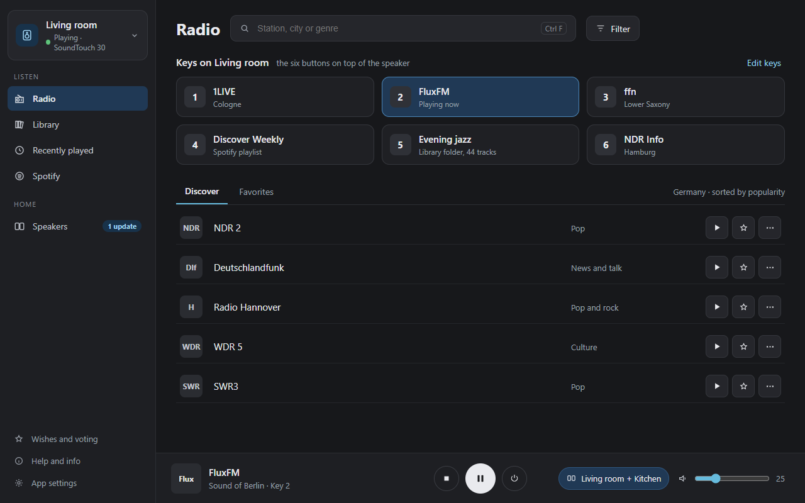
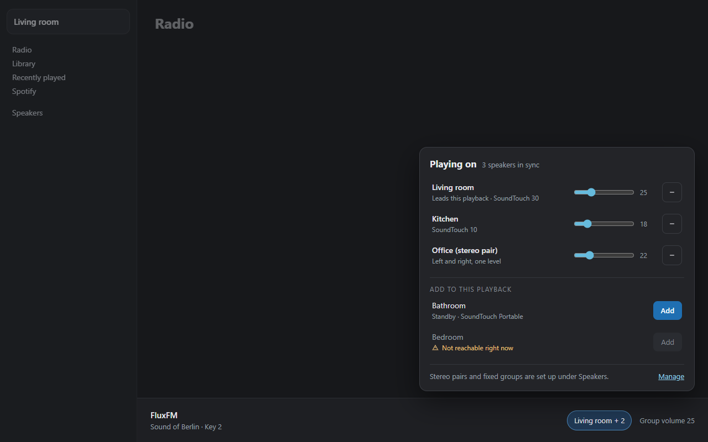
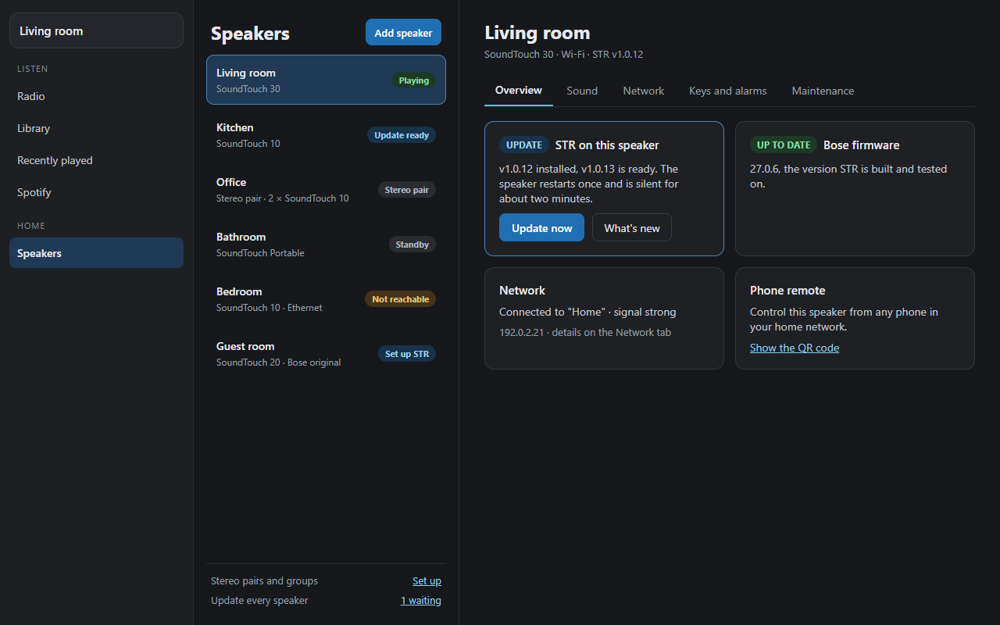
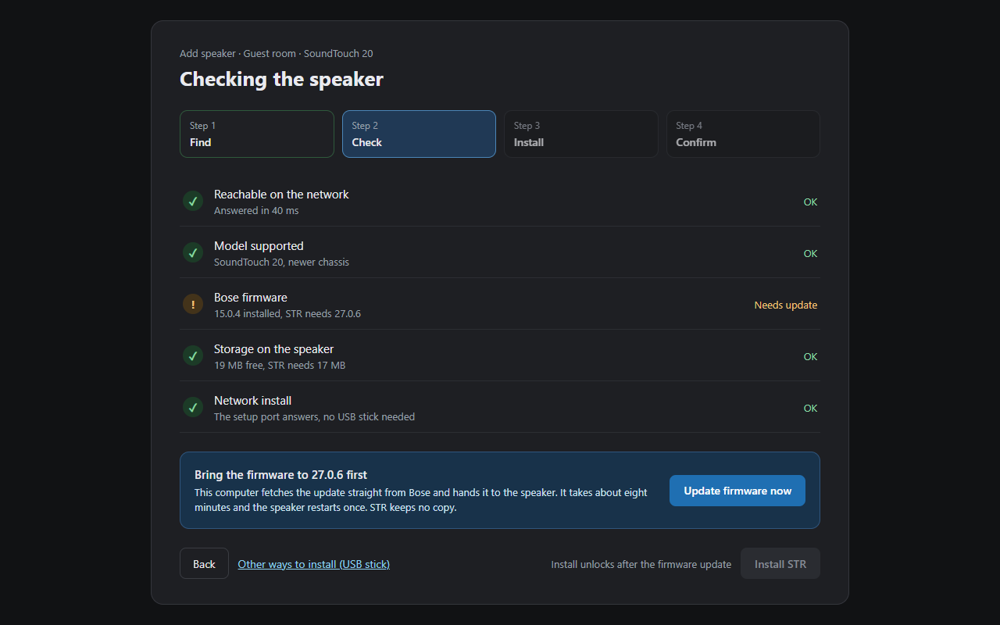
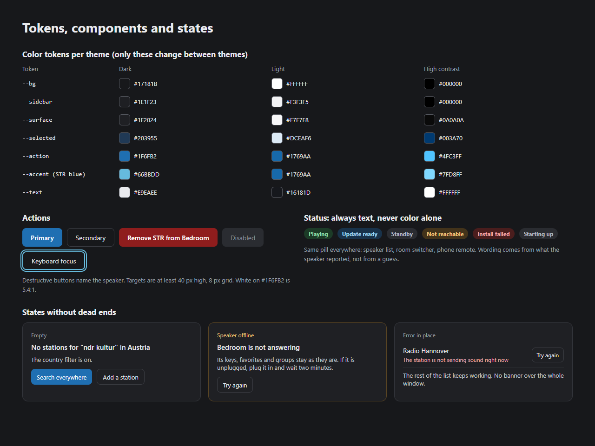
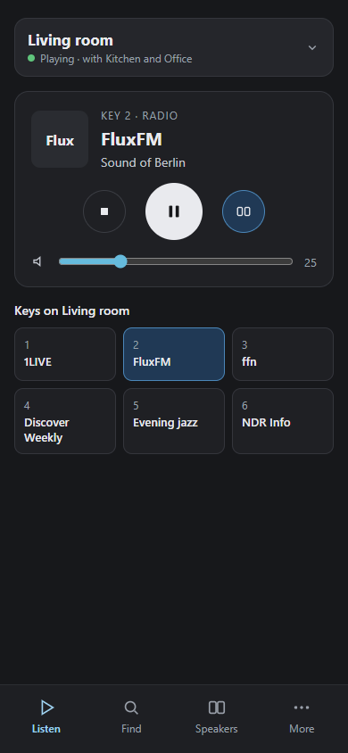

# UI 2.0: the new desktop layout

The desktop app grew one feature at a time, and its eight tabs follow the
technical layers more than what people do with it. In discussion #1278
DrDBanner proposed a full concept that sorts it into listening, controlling
and setting up, without dropping a single function. This page records how we
reviewed that concept and what we changed, so the decisions live next to the
code. Progress is tracked in the UI 2.0 tracking issue (label `ui-2.0`).

The images below are design mockups with sample data, not screenshots of the
app.

## How it ships

As a preview that can be switched on in the settings, next to the current
layout. The new layout is a new shell (sidebar, persistent player, settings
structure) around the existing view modules and the same state, so a feature
added during the transition lands in both layouts. When the preview covers
everything, it becomes the default and the old layout is removed one or two
releases later.

## Four rules for every view

1. **The speaker is always named.** Every action says which speaker it acts
   on.
2. **Honest feedback.** Sent is not arrived. Done only when the speaker has
   confirmed it.
3. **Errors where they happen.** A broken station reports in its row, an
   offline speaker in its card; no window-wide banner for a local problem.
4. **Nothing disappears.** Every current function has a fixed new place (see
   the mapping below).

## Navigation, current and new

| Today (8 tabs) | UI 2.0 |
|---|---|
| Listen to music | Radio |
| Library | Library |
| Recently played | Recently played |
| Spotify | Spotify |
| Multi-room | Sidebar speaker list (who plays along: `+` on a speaker, `−` to take it out), Speakers > Groups (stereo pairs, fixed groups) |
| Speaker settings | Speakers > one speaker |
| Set up speaker | Speakers > Add speaker (wizard) |
| Wishes | Sidebar, bottom; Help and info |

## What we take from the concept

- Sidebar plus a player that stays in place on every view.
- Favorite and key are two named actions: saving a station is not assigning
  a hardware button.
- Technical details (codec, bitrate, stream address) live in the station
  details, not in the list.
- Group volume in the player, the individual levels in a compact panel
  opened from it (Levels).
- Restart, remove and reset sit in a separate maintenance context, confirmed,
  and the confirmation names the speaker.
- Help and info is one fixed place. Support links appear only there, never as
  a banner in the music views.
- Every empty, loading, offline and error state explains what happened and
  what can be done next. Status is never shown by color alone.

## What we change, and why

- **Every speaker in the sidebar** (DrDBanner's proposal in the #1284
  discussion, adopted on 14 October). In the concept the speaker only
  appears in the player; keys, now playing and most settings belong to one
  speaker, so the speakers are the anchor of the whole window. One list
  answers both questions: which speaker you control (one click on its row)
  and who plays along (`+` on an idle speaker adds it to what's playing,
  `−` takes a member out again). Choosing a row and its `+` are two
  different clicks. A stereo pair is one row, "Living room (stereo)",
  because it only plays as a whole. The playing group stays pinned on
  top (the one you control first when several play; with nothing playing,
  the speaker you control, so a group can be put together before Play);
  with many speakers the rest of the list scrolls on its own, so the music
  entries below it never scroll away. Offline speakers are greyed and
  say "Offline"; Bose originals say "Ready for STR" and open the setup. This
  replaces the room switcher and the separate output popover of the first
  draft.
- **A speaker's settings live on its page, Speakers > one speaker** (the
  open question "where do speaker settings live" from the concept). The page
  always shows the speaker you control: opening a speaker from the Speakers
  list makes it the controlled one, and choosing another row in the sidebar
  while the page is open moves the page with it. The sidebar row itself stays
  one click (choose) plus `+` / `−`; it gets no second settings button.
  Its five tabs hold every section of today's Speaker settings: Overview
  (STR and Bose firmware, update, network summary, phone remote, name,
  language, sources), Sound (volume, balance, bass, levels, display and
  playback, announcements), Network (Wi-Fi, region, music libraries,
  Pandora and iHeartRadio), Keys and alarms (button repair, remote key map
  and key actions, copy keys, keys from an address, voice control) and
  Maintenance (identify, logs, support, restart, reset, remove STR, backup,
  SSH, other tools' changes). The checklist is `SPEAKER_SECTIONS` in
  `shell2/speakers/speaker.js`; every confirmation there names the speaker.
- **Volume in the player.** While a group plays, the group volume takes the
  place of the speaker volume, and Levels opens the per-speaker sliders.
  Levels only sets levels; choosing speakers stays in the sidebar.
- **Favorites are app-wide**, not per speaker (open point P1 in the concept).
- **Stereo pairs and fixed groups are set up under Speakers**, not in the
  playback popover. Taking a speaker in or out of the current playback stays
  in the sidebar speaker list (`+` / `−`).
- **Action color with enough contrast.** White on the concept's `#0A84FF`
  reaches 3.6:1. Primary actions use `#1F6FB2` (5.3:1); STR blue `#6BD` stays
  the accent.
- **Platform-neutral shortcuts.** Most users are on Windows: Ctrl, not Cmd.

## What we add

- **Firmware check in the setup wizard.** A speaker below firmware 27.0.6 is
  updated in place before STR is installed (docs/FIRMWARE-UPDATE.md).
- **STR's real speaker states** in one status pill used everywhere: playing,
  update ready, standby, starting up, offline, stereo pair, Bose original
  (set up STR).
- **One place for updates**, for the app and every speaker, matching the
  speaker self-update from the phone (docs/SELF-UPDATE.md).
- **Spotify with keys:** put the playlist that is playing on a key directly.
- **Wishes stay visible**, small at the bottom of the sidebar. The Ideas vote
  is the backlog.
- **Three themes:** dark, light and high contrast; only color tokens change.
- **The phone remote follows the same structure:** the speaker list on top,
  then Listen, Find, Speakers, More.

## Color tokens

As defined in `desktop-app/frontend/src/shell2/shell2.css`; the contrast of
every pairing is checked by `shell2/tokens.test.js`.

| Token | Dark | Light | High contrast |
|---|---|---|---|
| `--u-bg` | `#17181B` | `#FFFFFF` | `#000000` |
| `--u-sidebar` | `#1E1F23` | `#F3F3F5` | `#000000` |
| `--u-surface` | `#1F2024` | `#F7F7F8` | `#0A0A0A` |
| `--u-selected` | `#203955` | `#DCEAF6` | `#003A70` |
| `--u-action` | `#1F6FB2` | `#1769AA` | `#4FC3FF` |
| `--u-accent` | `#66BBDD` | `#1769AA` | `#7FD8FF` |
| `--u-text` | `#E9EAEE` | `#16181D` | `#FFFFFF` |
| `--u-muted` | `#A9ADB6` | `#565B66` | `#E0E0E0` |
| `--u-border` | `#6E727C` | `#767B85` | `#FFFFFF` |
| `--u-ok` | `#5CC98A` | `#1A6B3C` | `#7CFFB2` |
| `--u-warn` | `#E8B84A` | `#8A5A00` | `#FFD54A` |
| `--u-danger` | `#FF7A6E` | `#B3261E` | `#FF8A80` |
| `--u-focus` | `#66BBDD` | `#1769AA` | `#FFFFFF` |

The sidebar speaker list adds no colour token, only two sizes:
`--u-spk-row` (one row) and `--u-spk-visible` / `--u-spk-pinned` (how many
rows show before the other speakers, or a large pinned group, scroll).
An offline speaker is greyed with `--u-muted`, never with opacity, so its
name keeps 4.5:1.

Spacing on an 8 px grid, targets at least 40 px high, the system UI font.
Contrast, keyboard focus, screen reader names and enlarged text are
acceptance criteria for every phase.

## Phases

1. Tokens and components; the shell with the speaker sidebar (every
   speaker, `+` to play along, the playing group pinned) and the
   persistent player with group volume and per-speaker levels.
2. Radio, Library, Recently played, Spotify.
3. Speakers: list, one speaker, groups and stereo pairs.
4. Setup wizard with the firmware check.
5. States, Help and info, the phone remote.
6. Default for everyone; the old layout is removed.

Each phase ships with screenshots, the vitest suite green and every string in
all bundles. The preview is also checked in a browser against simulated
speakers in CI (`desktop-app/frontend/screenshots/ui2-check.mjs`).

## Mockups

The Radio and Output mockups predate the sidebar decision on #1284: the
room switcher and the output popover they show are replaced by the sidebar
speaker list and Levels in the player.

Radio with the room switcher, keys and player:

Output: who plays along, with individual levels:

Speakers, one selected:

Setup wizard, check step with the firmware update:

Tokens, components and states:

Phone remote:

